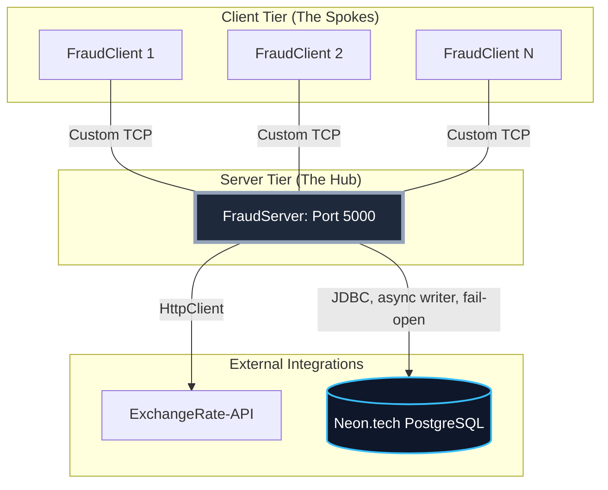

# FraudNet: Distributed Financial System


## Overview
FraudNet is a distributed financial system designed to process and simulate high-risk banking transactions in real-time. Built with a decoupled Hub-and-Spoke architecture, it acts as a lightweight ATM/POS simulator that communicates with a centralized engine to normalize currencies, evaluate Anti-Money Laundering (AML) rules, and persist audit logs.



## Core Features
* **Custom TCP Protocol:** Uses a lightweight, delimiter-based application protocol over raw TCP Sockets (Port 5000) to minimize overhead.
* **Real-Time Currency Normalization:** Integrates with the ExchangeRate-API via Java's `HttpClient` to convert local currencies to EUR on the fly.
* **Automated AML Detection:** Evaluates normalized transaction values against security thresholds (e.g., > €2000) to flag suspicious behavior.
* **Asynchronous Audit Ledger:** Every transaction is handed to a single background writer thread (bounded queue of 1,000 entries) that persists it via JDBC to a serverless PostgreSQL instance on Neon.tech. Client threads never wait on the database; if it is slow or down, writes time out and are logged as failures (fail-open), and pending entries are flushed on shutdown.
* **High-Concurrency Server:** Uses a Fixed Thread Pool to manage simultaneous client connections without resource exhaustion.

## Tech Stack
* **Language:** Java SE 21+
* **Networking:** `java.net.Socket`, `java.net.ServerSocket`, `java.net.http.HttpClient`
* **JSON Processing:** Google Gson
* **Database & Persistence:** JDBC, PostgreSQL, Neon.tech (Serverless DB)
* **Infrastructure:** AWS EC2 (Ubuntu Linux)

## Getting Started

### Prerequisites
* Java Development Kit (JDK) 21 or higher.
* Server: inbound TCP access on port 5000.
* Client: outbound TCP access to the server on port 5000.
* A valid Neon.tech PostgreSQL connection string.

Note: Ensure you have set the NEON_DB_URL environment variable in your terminal before starting the server.

### 1. Building from Source
Clone the repository and package the application using Maven:
```bash
mvn clean package
```

This will generate the executable .jar file in the /target directory.

### 2. Deploying the Server (Hub)
The server acts as the centralized execution node. You can run this locally or deploy it to a cloud VM.

```bash
# Execute the application artifact
java -cp target/fraudnet-lite-1.0-SNAPSHOT.jar com.student.server.FraudServer
```
Expected Output: >>> FraudNet HQ Initialized. Listening on port 5000

### 3. Running the Client (Spoke)

The client simulates a physical ATM or Point-of-Sale terminal. You can spin up multiple instances of this across different machines. It only needs JDK 21 and the jar; no database or AWS access.

```bash
# Launch the terminal interface: FraudClient [server-host] [port]
java -cp target/fraudnet-lite-1.0-SNAPSHOT.jar com.student.client.FraudClient <server-ip>

# Same machine as the server (host defaults to localhost, port to 5000)
java -cp target/fraudnet-lite-1.0-SNAPSHOT.jar com.student.client.FraudClient
```

The host can also be set with the `SERVER_IP` environment variable. If the server can't be reached within 5 seconds, the client reports the address it tried; check that the server is running and that port 5000 is open on both sides (e.g. the EC2 security group inbound rule).

## Usage

Once the client connects to the server, it will prompt you for input. The payload strictly expects a delimiter-based format: UserID;Amount;Currency.
Scenario A: Standard Approved Transaction

```
> Enter Transaction (Format: UserID;Amount;Currency) OR type 'EXIT':
> bob;50;EUR
SERVER RESPONSE: ACK|APPROVED;Transaction Clear
```

Scenario B: Dynamic Currency Normalization

```
> Enter Transaction (Format: UserID;Amount;Currency) OR type 'EXIT':
> alice;500;RON
SERVER RESPONSE: ACK|APPROVED;Transaction Clear

(The server automatically detects RON, fetches the live market rate, calculates the EUR equivalent, and approves it).
```

Scenario C: High-Value Fraud Detection

```
> Enter Transaction (Format: UserID;Amount;Currency) OR type 'EXIT':
> criminal;25000;RON
SERVER RESPONSE: ACK|FLAGGED;High Value (4950.50 EUR)
```

## Project Structure
```
src/main/java/com/student/
├── client/
│   └──  FraudClient.java     # Terminal simulator and user IO
├── server/
│   ├── FraudServer.java     # Main socket listener and thread pool manager
│   ├── CurrencyService.java # External REST API integration logic
│   ├── ClientHandler.java   # Runnable task handling individual client lifecycles
│   └── DatabaseService.java # JDBC connection and SQL execution logic
└── common/
    └── Protocol.java        # Shared constants and protocol definitions
```

## Current Limitations & Trade-offs
As a proof-of-concept, this system makes a few deliberate architectural trade-offs:    
* **Security:** The custom TCP protocol currently transmits data in plaintext. A production version would require wrapping the sockets in SSL/TLS.
* **Authentication:** Terminal identity relies on IP configuration rather than cryptographic handshakes (e.g., OAuth2 or mTLS).
* **Data Consistency:** The audit write is asynchronous and happens after the client receives its response. This keeps the system fast and available during database outages, but an entry can be lost if the database stays down, the queue fills up, or the server crashes before flushing. A real banking ledger would persist before acknowledging, or use a durable queue / transactional outbox, to guarantee every transaction is recorded.

## License

This project was developed for academic and portfolio demonstration purposes.
